<!-- ═══════════════ CABEÇALHO ═══════════════ -->
<p align="center">
  
</p>

<p align="center">
  
</p>

<p align="center">
  <a href="https://ndelecrodev.github.io/curriculum_website/"></a>
  <a href="https://github.com/ndelecrodev?tab=followers"></a>
  
</p>



<!-- ═══════════════ SOBRE ═══════════════ -->
##  Sobre

```python
nicolas = {
    "papel":      "Desenvolvedor de software",
    "local":      "São Paulo, SP",
    "foco":       ["FastAPI", "Django", "APIs REST", "Integrações"],
    "tambem":     ["Java", "Spring Boot", "PostgreSQL"],
    "entrega":    ["Testes automatizados", "CI/CD", "Documentação"],
    "disponível": "Aberto a conversas e oportunidades em diferentes áreas",
}
```

Desenvolvo APIs, pipelines de integração e aplicações web com arquitetura em camadas, validação de dados e testes automatizados. Gosto de sistemas simples de operar, bem documentados e que continuam fáceis de mudar depois de entregues.

<br/>

<!-- ═══════════════ PROJETOS ═══════════════ -->
##  Projetos

| Projeto | Descrição | Tecnologias |
|---|---|---|
| [**task-time-sync**](https://github.com/ndelecrodev/task-time-sync) | Pipeline que consolida tarefas do Jira e horas do Clockify em Excel (Backblaze B2) e Postgres, com alertas de prazo no Teams. Execução diária por GitHub Actions. | Python, Pydantic, SQLAlchemy, Postgres, Poetry, pytest |
| [**quimia-web-crud**](https://github.com/Quimia-br/quimia-web-crud) | Painel administrativo do Quimia, com auditoria, restauração de exclusões e mais de 160 testes. Projeto em equipe, ExpoTech 2026. | Java, Spring Boot, Spring Security, PostgreSQL |
| [**quimia-dashboard**](https://github.com/ndelecrodev/quimia-dashboard) | Dashboard estático com login e controle de acesso por Row Level Security, para acompanhar tarefas e horas do time. Exporta CSV e XLSX. | JavaScript, Chart.js, Cloudflare Pages |
| [**quimia-landingpage**](https://github.com/Quimia-br/quimia-landingpage) | Site institucional do Quimia, responsivo e acessível, publicado em [quimia.tech](https://quimia.tech). Projeto em equipe, ExpoTech 2026. | HTML, CSS, JavaScript, GitHub Pages |
| [**task-time-sync-docs**](https://github.com/ndelecrodev/task-time-sync-docs) | Documentação bilíngue (PT/EN) do pipeline e do dashboard: arquitetura, modelo de dados e decisões de design. | MkDocs Material, i18n |

<br/>

<!-- ═══════════════ STACK ═══════════════ -->
##  Stack

| | |
|:--|:--|
| **Linguagens** |  |
| **Frameworks** |  |
| **Banco de dados** |  |
| **Ferramentas e entrega** |  |

<sub>Também: Pydantic, SQLAlchemy, pytest, Poetry, MkDocs, Codecov, Sentry, Better Stack, Backblaze B2, Power Automate e Excel.</sub>

<br/>

<!-- ═══════════════ NÚMEROS ═══════════════
     Cartão de números e linguagens gerado no próprio repositório (workflow), sem serviço de terceiros. -->
##  Em números

<p align="center">
  <picture>
    <source media="(prefers-color-scheme: dark)" srcset="https://raw.githubusercontent.com/ndelecrodev/ndelecrodev/output/stats-dark.svg"/>
    
  </picture>
</p>

<p align="center">
  
</p>

<p align="center">
  <picture>
    <source media="(prefers-color-scheme: dark)" srcset="https://raw.githubusercontent.com/ndelecrodev/ndelecrodev/output/activity-dark.svg"/>
    
  </picture>
</p>

<br/>

<!-- ═══════════════ CONQUISTAS ═══════════════ -->
##  Conquistas

<a href="https://github.com/ndelecrodev?tab=achievements"></a>&nbsp;
<a href="https://github.com/ndelecrodev?tab=achievements"></a>&nbsp;
<a href="https://github.com/ndelecrodev?tab=achievements"></a>&nbsp;
<a href="https://github.com/ndelecrodev?tab=achievements"></a>

<br/>

<!-- ═══════════════ ATIVIDADE ═══════════════ -->
##  Atividade

<p align="center">
  <picture>
    <source media="(prefers-color-scheme: dark)" srcset="https://raw.githubusercontent.com/ndelecrodev/ndelecrodev/output/minesweeper-dark.svg"/>
    
  </picture>
</p>

<br/>

<!-- ═══════════════ AGORA ═══════════════ -->
##  Foco atual

<table>
  <tr>
    <td width="40"></td>
    <td><b>APIs e aplicações web</b> com FastAPI e Django</td>
  </tr>
  <tr>
    <td width="40"></td>
    <td><b>Arquitetura em camadas</b>, testes e integração com APIs em Python</td>
  </tr>
  <tr>
    <td width="40"></td>
    <td><b>Java e Spring Boot</b> em projetos em equipe</td>
  </tr>
  <tr>
    <td width="40"></td>
    <td><b>GitHub Foundations</b> (DataCamp)</td>
  </tr>
  <tr>
    <td width="40"></td>
    <td><b>Aberto a</b> conversas e oportunidades em diferentes áreas</td>
  </tr>
</table>

<br/>


<!-- ═══════════════ RODAPÉ ═══════════════ -->
<p align="center">
  <a href="https://ndelecrodev.github.io/curriculum_website/"></a>
  <a href="https://github.com/ndelecrodev"></a>
</p>


